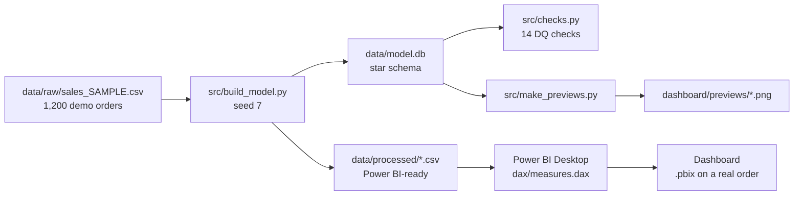
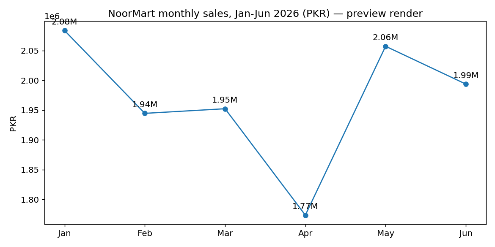
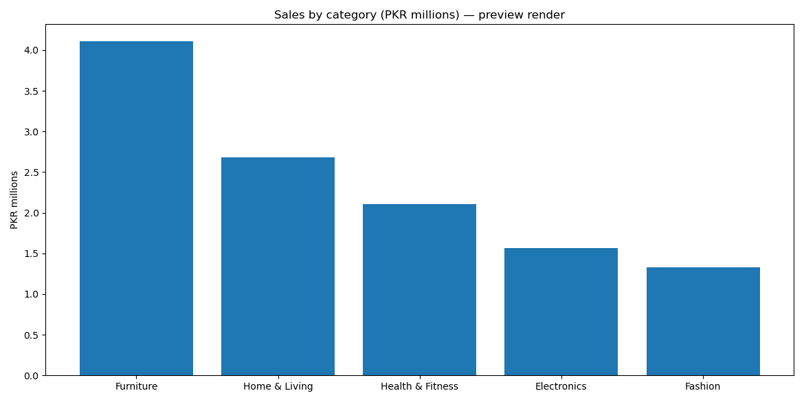
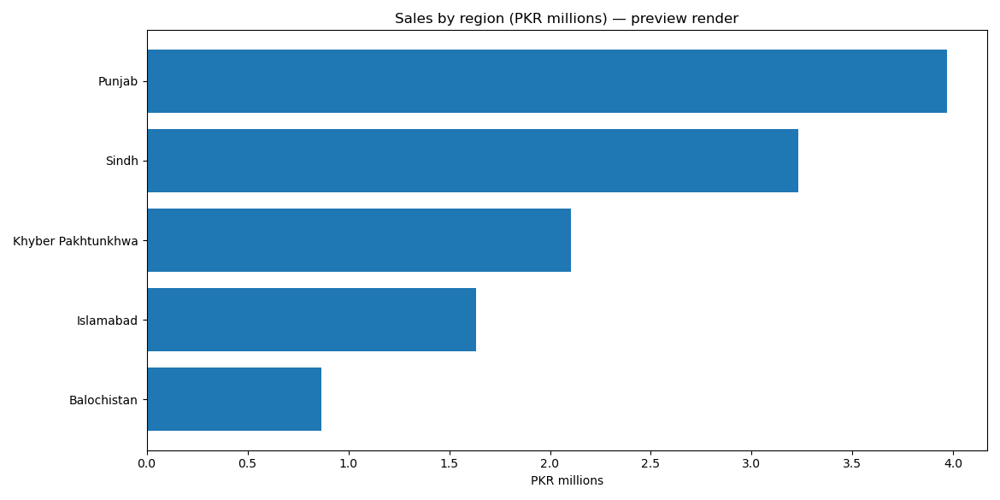

# P3 — Power BI Business KPI Dashboard: Sales & Profit by Region, Product and Channel

**Repo:** https://github.com/mhkh-stock/p3-powerbi-kpi-dashboard

**Shop:** NoorMart (fictional) · **Period:** Jan–Jun 2026 · **Status: SAMPLE delivery on DEMO data**
**Tools:** Power BI (DAX) · SQL star schema (SQLite) · Python (pandas)
**Model:** `data/model.db` + `data/processed/*.csv` (Power BI-ready) · **Measures:** `dax/measures.dax`
**Build guide:** `dashboard/powerbi-build-guide.md` (import → relationships → measures → visuals, ~15 min)

> ⚠️ **Demo data only.** Every number here comes from a seeded generator
> (`src/build_model.py`, seed 7) for a fictional shop. It is **not** real
> client data and no real shop is named. The model, the DAX and the
> dashboard design are real; the client history is not claimed.

> **Honest note on the .pbix file:** no `.pbix` is bundled with this repo.
> Power BI Desktop (Windows) is required to author a real `.pbix`, and
> faking one would be dishonest. Instead this repo ships everything a
> real build needs — a clean star-schema model, the DAX measures, and a
> step-by-step build guide — plus preview renders of the same data
> (`dashboard/previews/`, made with matplotlib and labelled as renders,
> **not** Power BI screenshots). A buyer on a real order gets the finished
> `.pbix` built in Power BI Desktop from this exact model.

## How it fits together

## Business question it answers

> "Which products, regions and channels actually make us money — and where
> is profit leaking even though sales look fine?"

A sales total alone hides the story. This dashboard answers it with four
KPI cards (sales, profit, margin, average order value), a monthly trend,
sales by region and category, and a ranked product table — all fed from
one star-schema fact table, so every visual agrees on the same numbers.

## What is inside

| File | What it does |
|---|---|
| `data/model.db` | SQLite star schema: `fact_sales` + `dim_product` / `dim_region` / `dim_channel` / `dim_date` |
| `data/processed/*.csv` | The same model as CSVs — import these directly into Power BI |
| `data/raw/sales_SAMPLE.csv` | 1,200 generated transactions, untouched — the "before" |
| `sql/schema.sql` | The star-schema DDL (also loads into PostgreSQL with no changes except types) |
| `dax/measures.dax` | Copy-paste DAX: Total Sales, Total Profit, Profit Margin %, Orders, AOV, MoM growth, Top Product |
| `dashboard/powerbi-build-guide.md` | Relationships, measures, and the exact visual layout, step by step |
| `dashboard/previews/*.png` | Preview renders of the trend, category and region charts (matplotlib, labelled) |
| `outputs/insights.md` | Findings + 3 recommendations in plain English |
| `src/build_model.py` | Seeded generator + loader: re-run for identical numbers |
| `src/checks.py` | Data-quality checks as code — 14 checks, all passing |
| `src/make_previews.py` | Regenerates `dashboard/previews/*.png` from `data/model.db` |

## 3 key findings (from the demo data)

1. **Furniture carries the shop:** PKR 4,112,441 — **34.8% of sales**.
   Office Chair Ergo alone is PKR 1,591,488 (**13.5%**). *So what:* protect
   furniture availability first; a stock-out there costs more than anywhere else.
2. **April is the soft month, not a trend:** April PKR 1,773,350 vs January
   PKR 2,083,714 — a **14.9%** dip, with May bouncing back to PKR 2,057,292.
   *So what:* check April stock/pricing before cutting anything; the
   half-year trend is flat-to-stable, not falling.
3. **In-Store still leads, WhatsApp is the growth lever:** In-Store
   PKR 6,118,847 (**51.8%**), Online 32.6%, WhatsApp Order 15.6%.
   *So what:* the cheapest growth in this sample is lifting WhatsApp
   ordering from 15.6%, not chasing more footfall.

## Recommendation

Protect furniture availability first (it is 34.8% of sales), diagnose
April's dip before cutting anything, and grow WhatsApp ordering toward
Online's share — the cheapest growth lever in this sample. Full
reasoning: `outputs/insights.md`.

## Screenshots

Preview renders of the same demo data (matplotlib, **not** Power BI
screenshots — the real `.pbix` visuals are built from this exact model
on a real order; see the note at the top).

## Verified KPIs

| KPI | Value |
|---|---|
| Total sales | PKR 11,804,808 |
| Total profit | PKR 5,360,644 |
| Profit margin | 45.4% |
| Orders | 1,200 |
| Units sold | 1,632 |
| Average order value | PKR 9,837 |
| Best category | Furniture (PKR 4,112,441) |
| Best product | Office Chair Ergo (PKR 1,591,488) |
| Best region | Punjab (PKR 3,969,335) |
| Best month | January 2026 (PKR 2,083,714) |

Verification: `python3 src/checks.py` — 14 checks pass, including
fact total = raw CSV total (11,804,808), every `sales_amount` =
quantity × price, and every profit = quantity × (price − cost).

## How to run it (under 5 steps)

1. Open `dashboard/powerbi-build-guide.md` and follow it in Power BI
   Desktop (import the 5 CSVs in `data/processed/`, paste the DAX).
2. Or explore without Power BI: `sqlite3 data/model.db` and query
   `fact_sales` joined to any dimension.
3. To rebuild from scratch: `pip install -r requirements.txt`, then
   `python3 src/build_model.py` and `python3 src/checks.py`.
4. To reuse it for a real shop: replace `data/raw/` with real
   transactions in the same columns — the schema, DAX and layout
   already fit; only the product/region lists change.
5. Read `outputs/insights.md` before presenting it: findings first,
   then the dashboard.

## Tools

- Power BI Desktop (for the finished `.pbix` on a real order)
- Python 3 + pandas + matplotlib (build script and preview renders only)
- SQLite (the model database; PostgreSQL-ready schema)

## Data source note

**Demo/sample data, generated for this project** (seeded generator,
seed 7: 1,200 orders, Jan–Jun 2026, 20 products across 5 categories,
5 regions, 3 channels). Prices are realistic PKR ranges per product,
not real prices. No customer names or payment details exist in this
data — by design.

## Limits — what this does not claim

- **Demo data only:** 1,200 seeded SAMPLE orders for a fictional shop;
  no finding here describes a real business.
- **Six months, no year-on-year:** Jan–Jun 2026, so there is no YoY
  comparison — the MoM measures are the honest trend view.
- **Seeded costs, not supplier costs:** `unit_cost` is a fixed ratio of
  price per product, so margins are illustrative, not audited.
- **No bundled `.pbix`:** the finished file is built in Power BI
  Desktop from this model on a real order (see the note at the top).

## Repo standard note

This paid project follows the portfolio repo standard (Master Plan
§3.2), slimmed for a BI deliverable: README + data dictionary
(`data/README.md`) + the deliverable model + DAX + build guide +
preview renders + insights + a Fiverr-ready package note
(`PACKAGE-NOTE.md`) + reproducible scripts. The `.pbix` is honestly
absent (see the note at the top) and is built in Power BI Desktop on
a real order.
